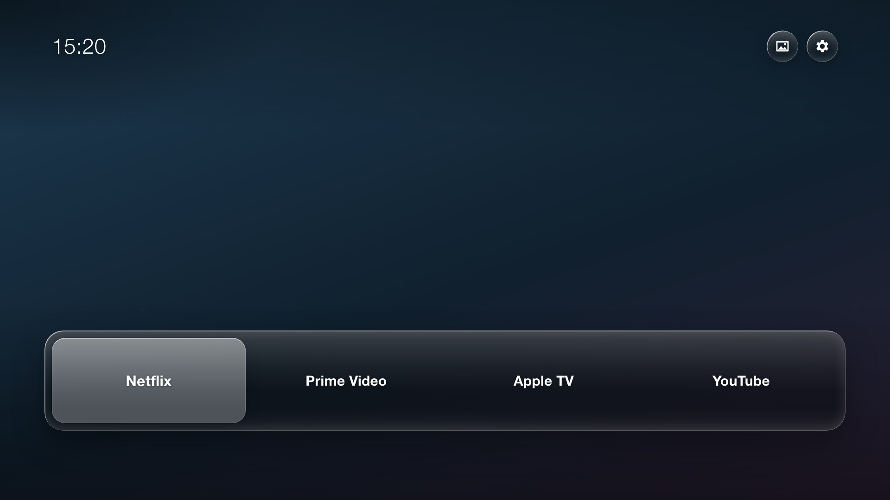

# Optional: Frame Launcher

A simple home screen for the Frame: a dock of your streaming apps over a wallpaper you pick (or
let rotate), with no ads or recommendations. **Not needed for privacy.** It is a Tizen web app
(HTML/JS) installed in Developer Mode.



## Build and install

Needs Tizen Studio (CLI is enough) with the TV extension, and a Samsung certificate profile made
in Tizen Studio's Certificate Manager for **your** TV's device ID. Signing and certificates are
never part of this repository.

1. Edit `app/js/apps.js`: list the apps you want. Read their ids from your TV with
   `sdb shell 0 applist`. Logos are optional: put your own white PNG in `app/img/glyph/` and set
   `glyph`; otherwise the card shows the name. (Logos are trademarks; this repo ships none.)
2. Optional wallpapers: `tools/wallpapers.sh` (zsh and ImageMagick) downloads the Wikimedia
   Commons photos in `tools/wallpapers.tsv`, makes 1080p, blurred and thumbnail copies in
   `app/img/wall/` and writes `app/js/wallpapers.js` with the credits. Without it the launcher
   shows a dark gradient.
3. Package and install:
   ```sh
   sdb connect TV_IP:26101
   tizen package -t wgt -s YOUR_PROFILE -- app
   tizen install -n 'Frame Launcher.wgt' -t YOUR_TV_MODEL
   ```
   Preview in a desktop browser by opening `app/index.html` at 1920x1080; launches show as a
   message there.

Remote: left/right to pick an app, OK to open, up for the wallpaper and settings buttons, Back
opens the normal TV view.

## Start it automatically (optional, needs root)

### Requirements

- The TV must be yours or otherwise under your administration.
- Install and validate the custom launcher before changing startup routing.
- Use the matching `quiet-tizen` helper/profile for the exact TV model and
  firmware. Do not use a profile copied from another model.
- Enable Developer Mode on the TV. In its Developer Mode dialog, set **Host PC
  IP** to the computer's current LAN IP. That field is the computer address,
  not the TV address; connect the helper to the TV's own IP.
- Have a tested temporary-root route and a saved rollback value before writing.

### Inspect, change, and verify

From `quiet-tizen/` (set up with `../setup.sh`), set the TV's current IP and exact firmware.
For this model, use the Frame profile:

```sh
TV_IP='192.0.2.50'
TV_FIRMWARE='T-PTMDEUC-1720.7, BT - S'
PROFILE='profiles/tq43ls03bguxxc-1720.7.json'
tv() {
  python3 tools/tv.py --host "$TV_IP" --firmware "$TV_FIRMWARE" \
    --profile "$PROFILE" "$@"
}
```

Check the target and root access before writing:

```sh
tv doctor
tv root-check
tv exec --command 'vconftool get db/appfw/home_appid; vconftool get db/appfw/startup_appid'
```

Record the exact current values. The trial below applies only if the custom app
is installed and Home already points to it. If either selector differs from
the expected values, stop and investigate instead of copying the write.

For the tested configuration, the guarded write was:

```sh
tv exec --command 'set -eu; test "$(vconftool get db/appfw/home_appid | sed -n "s/.*value = \([^ ]*\) (String)/\1/p")" = FrmLnchr01.FrameLauncher; test "$(vconftool get db/appfw/startup_appid | sed -n "s/.*value = \([^ ]*\) (String)/\1/p")" = org.tizen.tv-viewer; vconftool set -f -t string db/appfw/startup_appid FrmLnchr01.FrameLauncher; vconftool get db/appfw/home_appid; vconftool get db/appfw/startup_appid'
```

Then enable Samsung's native Smart Hub auto-start preference:

```sh
tv exec --command 'vconftool set -f -t int db/menu/smart_hub/ontvsetting/auto_start 1; vconftool get db/menu/smart_hub/ontvsetting/auto_start'
```

Confirm both app selectors say `FrmLnchr01.FrameLauncher` and auto-start reads
`1`. A successful readback proves the settings were stored; it does not prove
the launcher starts correctly after a reboot.

### Test the result

1. Use the TV's normal full-restart procedure. Standby/wake alone is not a
   cold-start test.
2. Confirm the custom launcher appears, navigation works, and Home still
   returns to it.
3. Press Back from the launcher and confirm the Samsung TV viewer opens if
   that is the launcher's configured Back behavior.
4. Test the apps, inputs, and settings you rely on.
5. Compare startup to a baseline using the same restart procedure. Record
   timings or describe the visible difference; don't infer a speedup from the
   setting readback alone.

### Roll back startup only

Restore the original startup target while leaving Home routed to the custom
launcher:

```sh
tv exec --command 'vconftool set -f -t int db/menu/smart_hub/ontvsetting/auto_start 0; vconftool set -f -t string db/appfw/startup_appid org.tizen.tv-viewer; vconftool get db/appfw/home_appid; vconftool get db/appfw/startup_appid'
```

Verify startup reads `org.tizen.tv-viewer` and Home still reads
`FrmLnchr01.FrameLauncher`. Restart and confirm the prior behavior. If the
launcher fails at boot, use the same SDB connection and temporary-root helper
to restore the original startup value.

### Scope and caveats

- This is a routing change, not a debloat step. Do not uninstall or disable
  `org.tizen.tv-viewer` as part of this trial.
- The app ID must match the installed launcher's actual app ID. Check it on the
  target TV rather than assuming it is the same on another installation.
- Samsung firmware updates or app reinstalls can change app routing behavior;
  re-read both selector values after updates.
- Do not publish TV IP addresses, serial numbers, credentials, root session
  logs, private backups, or generated device-specific registry dumps.
